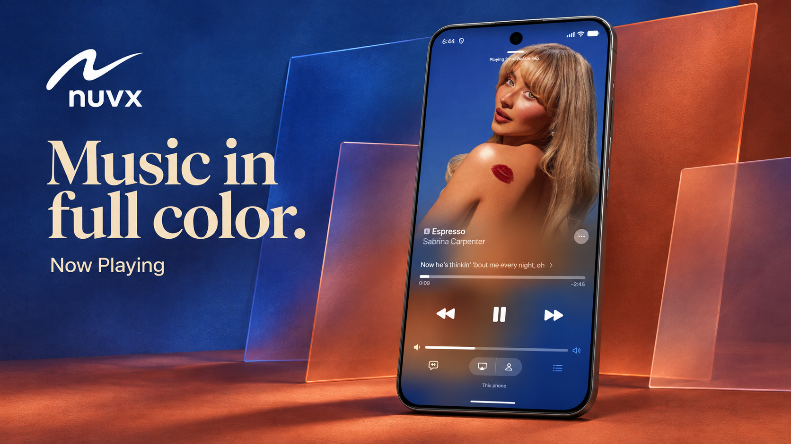
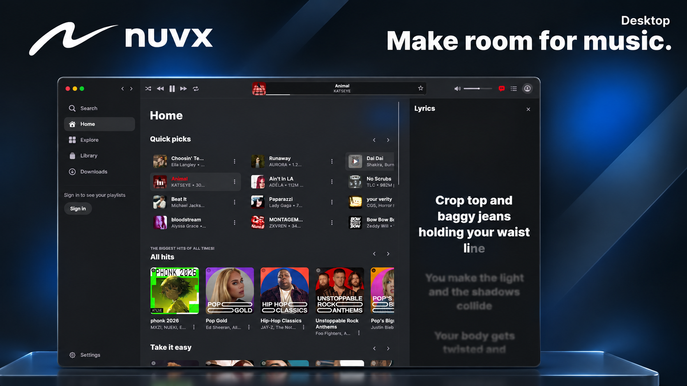
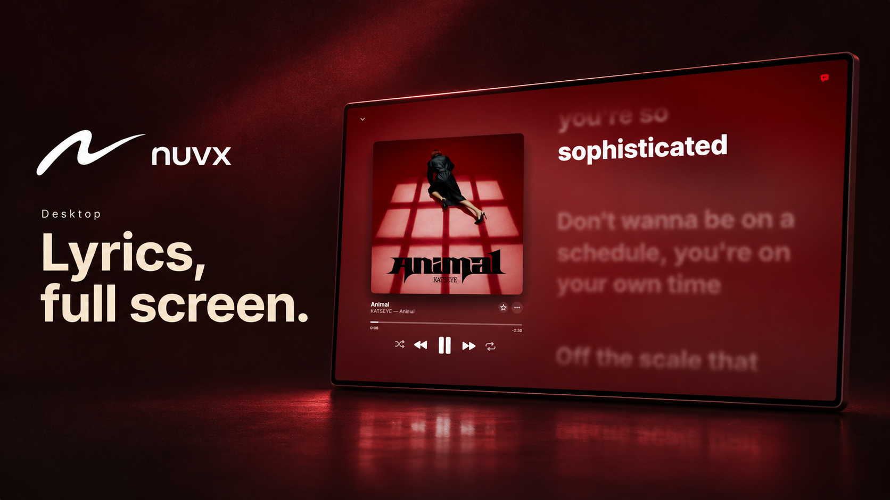

# Changelog

Every nuvx release, newest first. Downloads and checksums are on each version's [GitHub release](https://github.com/bxanedot/nuvx/releases).

## 0.5.0

### Podcasts

Desktop and Android phones and tablets get a Podcasts tab beside Radio, with shows and episodes from YouTube Music. The first time you open Radio or Podcasts, nuvx asks whether to keep the tab. Either one can be hidden later in Settings.

### YouTube search

Turn on **Enable YouTube Search** in Settings to add a YouTube switch over your search results, for videos that YouTube Music doesn't carry. It's off by default.

### Expanded player

- Queue and Lyrics now sit beside Repeat.
- Shuffle replaces Start radio in the ⋯ menu.
- On desktop, Lyrics sits on the far left, before Shuffle.
- On desktop, a music video can switch between the video and the song from the ⋯ menu.

### Desktop

- The player in the top bar takes after Apple Music's: a sharp display in the middle with the song, its artwork and a thin progress line, the controls to its left, and volume, lyrics and up next to its right. Volume opens its slider when you hover over it.
- Android's equalizer comes to desktop, with its Dynamic tone pad, seven Manual bands and presets, and balance. Find it in Settings.
- Desktop gets Android's spatial audio, on by default.
- The red, yellow and green window buttons close, minimize and maximize, as the Windows buttons do.
- Scrollbars are gone. Pages still scroll with the wheel, trackpad or touch.
- The app's own window background is now called Dynamic. Your choice is kept.
- Ctrl+F opens Search from any page, ready to type. F shows full-screen lyrics whenever a song is loaded, and keeps working after you click a button.
- Release notes show pictures, tables, numbered lists, quotes and line breaks as GitHub does. Android's notes keep their line breaks and pictures too.

### Websites

nuvx.lol has this changelog at [nuvx.lol/changelog](https://nuvx.lol/changelog). nuvx.lol and the web player now wear burgundy.

## 0.4.0

### Radio

Desktop now has Android's Radio tab. Pick a country (yours comes first) to hear its most played live stations, or search all of them. The broadcast icon in the sidebar bounces like the other tabs and pulses while a station is on air.

### Software Update

When a new version has downloaded, desktop now shows it the way Android does: a Software Update alert with What's New, and Install Now or Later.

### Cleaner source

Dead code, unused theme thumbnails and deprecated calls are gone from the desktop app.

  
  

## 0.3.0

### Moods and genres in pictures

On desktop, the Moods and genres tiles on Search and Explore now carry cover art from the playlists they open, in the same duotone style as Android. The tiles appear at once and their pictures fill in a few seconds later.

## 0.2.0

### Meet nuvx for desktop

nuvx 0.2.0 brings your music to Windows, Linux and macOS. Explore YouTube Music by mood or genre, follow synced lyrics beside the expanded player, and listen with friends through Listen Together.

The desktop app keeps playback controls at the top and gives Up Next and Lyrics their own collapsible panels. Make it yours with an icon-only sidebar, animated GlyphStudio icons, and window materials that fit your platform.

This release also includes hotfixes for Android phones, tablets and TVs.

## 0.1.0

The first nuvx release, for Android phones and tablets, Android TV and Wear OS. Both APKs are universal and run on Android 8.0 or newer. Prefer the browser? Use the web player at [web.nuvx.lol](https://web.nuvx.lol).
