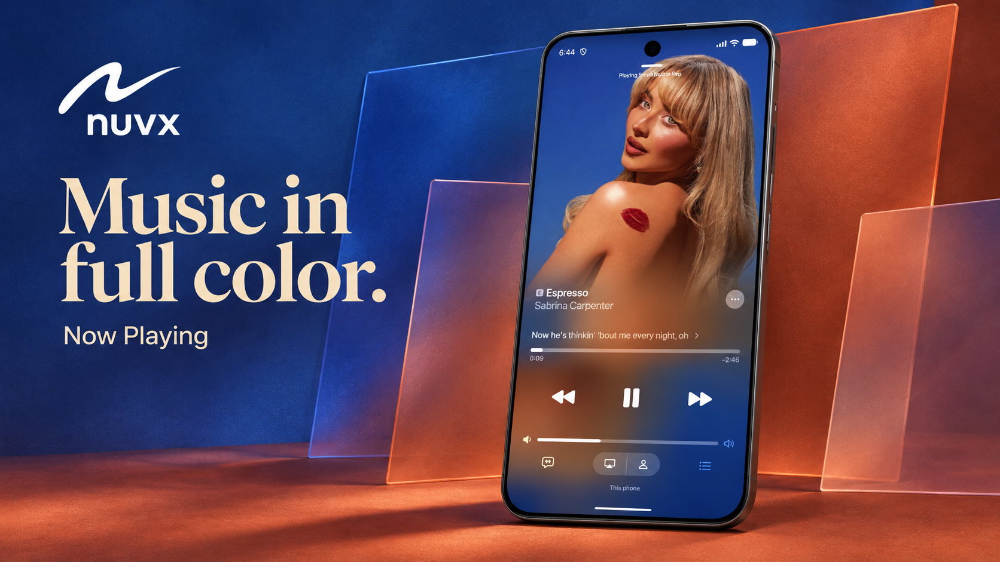
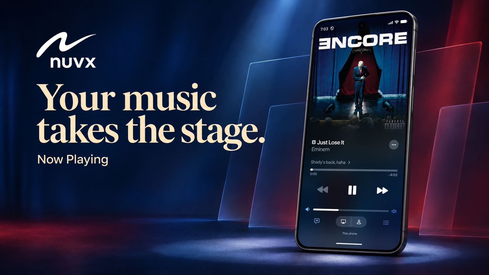
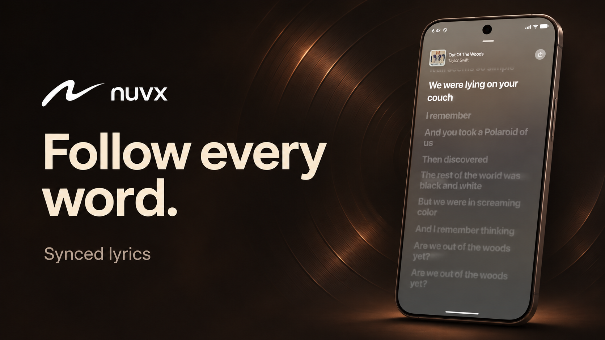
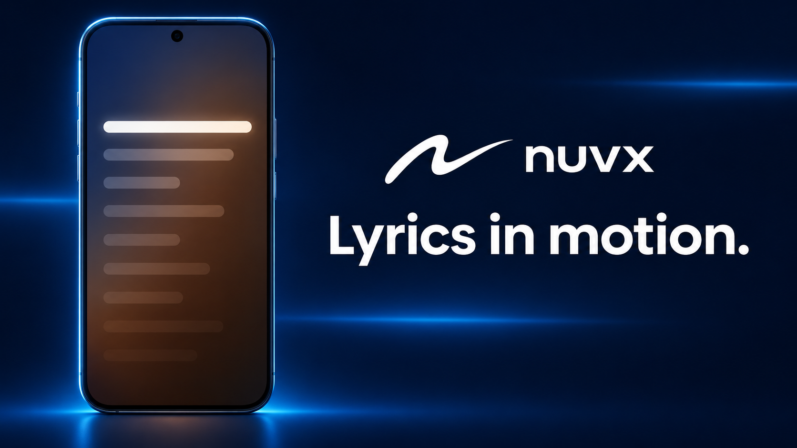
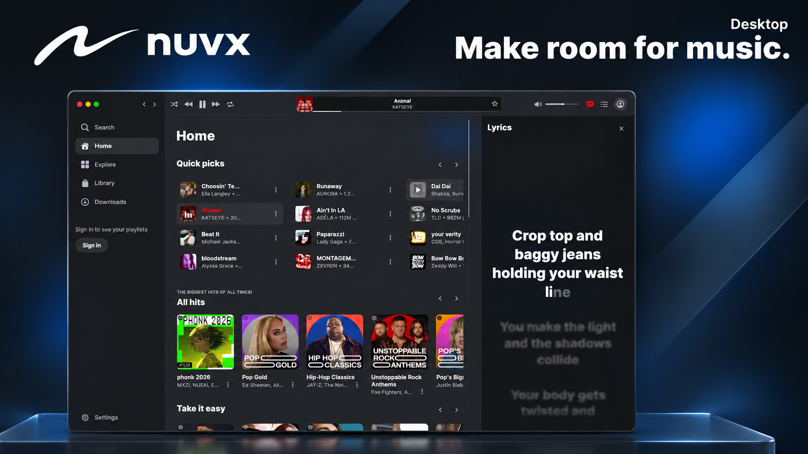
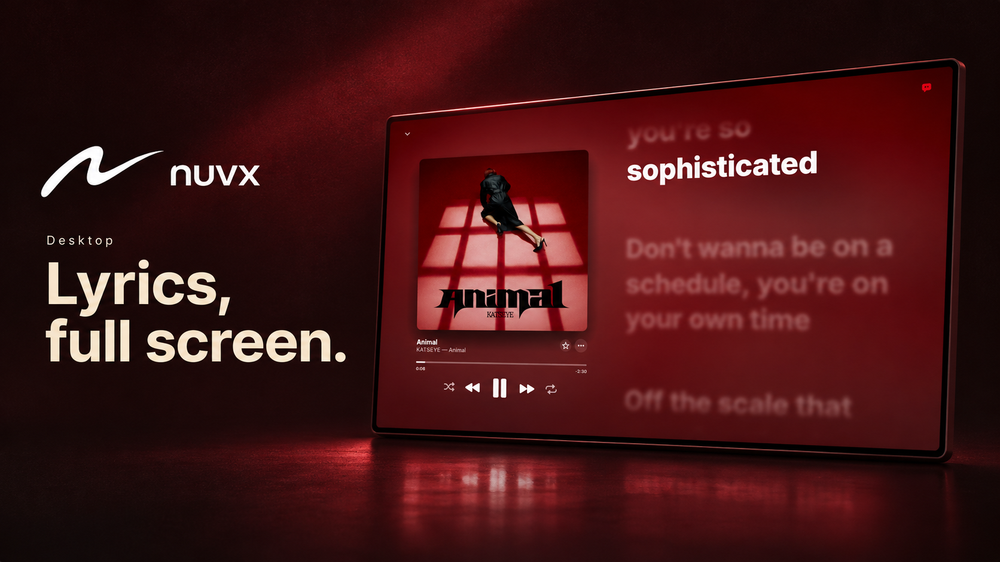

<p align="center">
  <picture>
    <source media="(prefers-color-scheme: dark)" srcset="core/brand/mark/nuvx_mark_white.png">
    
  </picture>
</p>

<h1 align="center">nuvx</h1>
<p align="center">An open-source YouTube Music player for your phone, TV, wrist, desktop and browser.</p>

<p align="center">
  <a href="https://github.com/bxanedot/nuvx/releases/latest"></a>
  <a href="LICENSE"></a>
  <a href="https://github.com/bxanedot/nuvx/releases"></a>
  <a href="https://nuvx-listen.bxane.workers.dev/api/stats/live"></a>
  <a href="https://nuvx-listen.bxane.workers.dev/api/stats/live"></a>
</p>

<p align="center">
  <a href="#download"><strong>Download</strong></a> ·
  <a href="#features">Features</a> ·
  <a href="#screenshots">Screenshots</a> ·
  <a href="#build-from-source">Build</a> ·
  <a href="https://web.nuvx.lol">Web player</a> ·
  <a href="https://discord.gg/h4Wsu824Uf">Discord</a>
</p>

---





<p align="center">
  <a href="docs/nuvx-banner-amber.png"></a>
  <a href="docs/nuvx-banner-lyrics-motion.png"></a>
</p>

<p align="center">
  <a href="docs/nuvx-banner-desktop.png"></a>
  <a href="docs/nuvx-banner-desktop-lyrics.png"></a>
</p>

## Features

- **Listen Together.** Share an invite and keep the queue and playback in sync with friends.
- **Synced lyrics.** Follow the words in the full-screen player.
- **Music discovery.** Browse new releases, explore by mood, and manage your library and queue.
- **Community Canvases.** Add motion artwork to Now Playing on supported players. [Browse the project](core/canvas/README.md)
- **Controls for each screen.** Navigate with a TV remote, control the phone app from Wear OS, or keep the desktop mini player close by.

## Download

| Device | Requirements | Where to start |
| --- | --- | --- |
| **Android phone or tablet** | Android 8.0+ | [Latest release](https://github.com/bxanedot/nuvx/releases/latest) · v0.9.0 uses its GMS/FOSS APKs; v1.0.0 uses `nuvx-v*-universal.apk` (one multi-ABI APK) |
| **Android Auto** | Compatible head unit + phone running nuvx | Install the phone app; its media service provides Android Auto playback controls |
| **nuvx Auto** | Compatible Android head unit | Planned for v1.0.0 · standalone `NuvxAuto-v*-universal.apk`; stereo widening starts off and loudness normalization stays enabled |
| **Android TV or Google TV** | Android 8.0+ | [Latest release](https://github.com/bxanedot/nuvx/releases/latest) · v0.9.0 uses its GMS/FOSS APKs; v1.0.0 uses `NuvxTV-v*-universal.apk` (one multi-ABI APK) |
| **Wear OS** | Wear OS 3+ and a paired Android phone running nuvx | [Latest release](https://github.com/bxanedot/nuvx/releases/latest) · separate `NuvxWear-v*.apk` companion |
| **iPhone** | iOS/iPadOS 18+; signing required | No IPA in v0.9.0; unsigned IPA planned for v1.0.0 · [build and sideload notes](app/ios/README.md) |
| **Windows** | Windows 10+, x64 or ARM64 | [Latest release](https://github.com/bxanedot/nuvx/releases/latest) · universal setup `.exe` |
| **macOS** | macOS 15+, Apple silicon or Intel | [Latest release](https://github.com/bxanedot/nuvx/releases/latest) · separate Apple silicon and Intel `.dmg` files |
| **Linux** | x86-64 or ARM64 | [Latest release](https://github.com/bxanedot/nuvx/releases/latest) · universal `.tar.gz` |
| **Web** | Chrome, Edge, Brave or Firefox on desktop, with the companion extension for full playback | [Web player](https://web.nuvx.lol) · [Extension setup](https://web.nuvx.lol/guide) |

The published v0.9.0 stable phone and TV assets are separate GMS and FOSS APKs. New Android builds use one shared universal APK for the phone, TV, and nuvx Auto, each containing armeabi-v7a, arm64-v8a, and x86_64. Cast and Wear features require Google Play Services. Phone and TV keep byte-identical `-gms` and `-foss` aliases for 0.9 updater compatibility; Auto has one canonical asset. Until stable `v1.0.0` is published, Android nightlies use version 0.9.0/code 9; stable 1.0.0 packages use code 10 and include nuvx Auto. Android Auto projection remains part of the phone app, and Wear OS ships as a separate APK. Windows and Linux installers include x64 and ARM64 builds; macOS provides separate Apple silicon and Intel `.dmg` files. Browser extensions share the main release tag. The Apple workflow builds an unsigned IPA as a 14-day workflow artifact and can attach it to an existing release when manually dispatched. Version 1.0.0 remains without a stable release or tag.

### Download troubleshooting

If YouTube temporarily refuses a track during an Android batch download, wait a moment and retry. Android now resolves download URLs one at a time to reduce request bursts; audio file transfers can still run concurrently.

iOS feature parity is partial: the iPhone app uses native SF Symbols and app-owned vectors instead of Android's GlyphStudio runtime, and does not yet include Android's eXcor playback fallback. See the [platform parity notes](app/ios/docs/ANDROID_PARITY.md) for the known differences and verification limits.

### Install and update on iPhone or iPad

1. Download `nuvx-<version>-universal.ipa` from a release. If a release has no IPA, download the `ios-unsigned` artifact from a successful **Apple builds** workflow run; workflow artifacts expire after 14 days and require a GitHub sign-in.
2. Sign and install the unsigned IPA with a sideloading tool such as Sideloadly, AltStore Classic, or SideStore. An unsigned IPA cannot be installed by opening it in Files or Safari. See the [iOS install guide](app/ios/README.md) for setup steps.
3. nuvx checks the latest stable GitHub release on launch. To check again, open **Settings → Version & Updates → Check for Updates**. When an update is available, download its IPA and install it through the same sideloading tool and Apple Account used for the current install. Install over the existing app; do not uninstall first if you want to keep local data.
4. Free Apple Account provisioning profiles expire after 7 days, so refresh the signature by re-signing and reinstalling before it expires. The in-app updater finds releases and downloads the IPA; signing and installation must be completed with the sideloading tool. [Apple's personal-team limits](https://developer.apple.com/help/account/basics/about-your-developer-account/) have the current details.

### Website search discovery

The public site exposes [`robots.txt`](https://www.nuvx.lol/robots.txt), which points crawlers to its [XML sitemap](https://www.nuvx.lol/sitemap.xml), and a root-hosted [IndexNow key](https://www.nuvx.lol/045adc84f9a240278c33ee11e35eff56.txt). Keep the sitemap limited to canonical pages and update `lastmod` when page content changes. After deploying URL changes, submit the affected canonical URLs through IndexNow. Submission requests discovery; search engines decide whether and when to list pages. See [website search indexing](docs/WEBSITE_SEARCH_INDEXING.md).

## How the counters work

- **GitHub downloads** totals installers and portable app packages across public GitHub releases. Updates and repeat downloads count too. Web visits and extension downloads from the web player are separate. [Download count](https://nuvx-listen.bxane.workers.dev/api/stats/downloads)
- **Online clients** counts apps and browsers that recently checked in to the official Listen Together server. The server deduplicates check-ins by a random client ID.
- **Listening Together** counts connected devices in parties with playback running on the official server. Paused parties are excluded. One person can use more than one device.

GitHub and badge caches can delay updates. [Current server counts](https://nuvx-listen.bxane.workers.dev/api/stats/live)

## Build from source

Android builds use Kotlin and Compose. Install JDK 25 and Android SDK Platform 37, then set `ANDROID_HOME` or add `sdk.dir` to `local.properties`.

```bash
./gradlew :app:assembleDevDebug     # phone and tablet
./gradlew :tv:assembleProdTvDebug   # Android TV and Google TV
./gradlew :tv:assembleProdAutoDebug # standalone nuvx Auto head-unit app
./gradlew :wearos:assembleDevDebug  # watch companion
```

On Windows, use `gradlew.bat`. For signing release builds, see [keystore.properties.example](keystore.properties.example).

| Project | Source and setup |
| --- | --- |
| Android apps | [Phone and Android Auto media support](app/android/mobile) · [TV and nuvx Auto](app/android/tv/README.md) · [Wear OS](app/android/wearos/README.md) |
| Desktop player | [Rust and egui](app/desktop/README.md) |
| Web player and extension | [React, TypeScript and WXT](app/web/README.md) |
| Shared code | [Kotlin](core/shared) · [Compose UI](core/sharedUi) · [Native audio](core/native) |
| Listen Together server | [Cloudflare Worker](core/worker/README.md) |
| Project assets | [Canvases](core/canvas/README.md) · [Website](core/website) · [Brand](core/brand/README.md) · [Third-party libraries](core/third_party/README.md) |

## Contribute

Found a bug or have an idea? [Open an issue](https://github.com/bxanedot/nuvx/issues) or join the [Discord](https://discord.gg/h4Wsu824Uf). See [Contributing](CONTRIBUTING.md), the [Code of Conduct](CODE_OF_CONDUCT.md), or the [nuvx website](https://www.nuvx.lol).

## License

nuvx uses [GPL-3.0](LICENSE) by default. Files with a different SPDX identifier keep that file-level license; the AGPL-marked components and their scopes are listed in [LICENSES.md](LICENSES.md), with the full [AGPL-3.0 text](LICENSE-AGPL-3.0.txt). Bundled third-party code keeps its own licenses. The [DST decoder](app/android/mobile/src/main/cpp/dsd/dst), for example, is under LGPL-2.1-or-later. The Android bit-perfect output also contains Mornye-adapted code under LGPL-3.0-only; see [LICENSES.md](LICENSES.md) and [the attribution](core/native/third_party/README.md). Android APKs include the project license texts and native notices under `assets/licenses/`; Android dependency notices remain under `META-INF/`.
