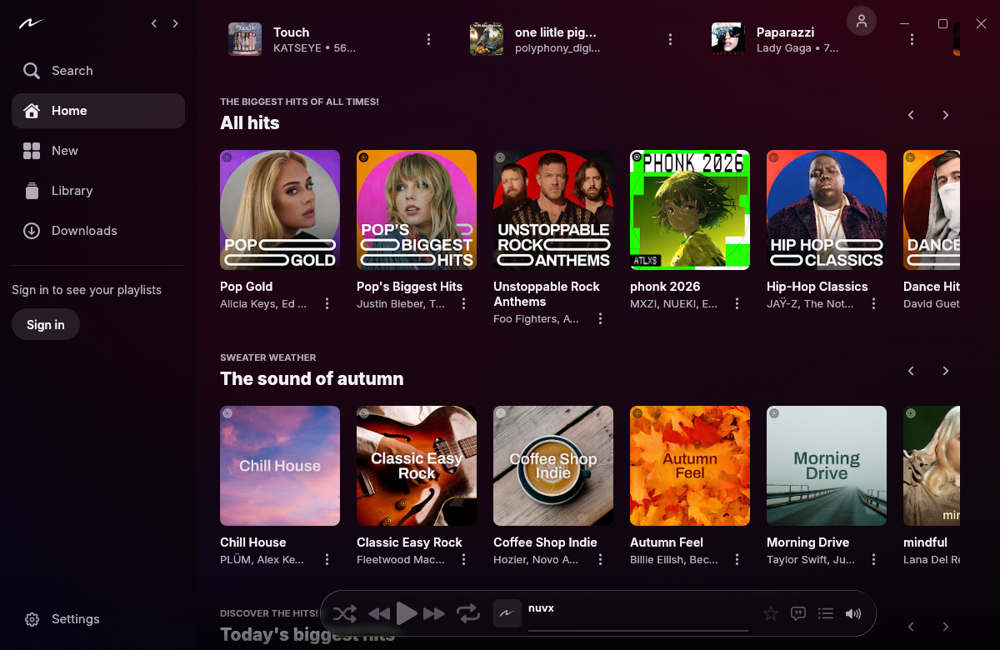

<p align="center">
  <picture>
    <source media="(prefers-color-scheme: dark)" srcset="core/brand/mark/nuvx_mark_white.png">
    
  </picture>
</p>

<h1 align="center">nuvx</h1>
<p align="center">An open-source YouTube Music player for your phone, TV, wrist, desktop and browser.</p>

<p align="center">
  <a href="https://github.com/bxanedot/nuvx/releases"></a>
  <a href="https://nuvx-listen.bxane.workers.dev/api/stats/live"></a>
  <a href="https://nuvx-listen.bxane.workers.dev/api/stats/live"></a>
</p>

<p align="center">
  <a href="https://github.com/bxanedot/nuvx/releases/latest"><strong>Get nuvx</strong></a> ·
  <a href="https://web.nuvx.lol"><strong>Open the web player</strong></a> ·
  <a href="https://www.nuvx.lol">Website</a> ·
  <a href="https://discord.gg/h4Wsu824Uf">Discord</a>
</p>

## Find your build

| Device | Requirements | Where to start |
| --- | --- | --- |
| **Android phone or tablet** | Android 8.0+ | [Latest release](https://github.com/bxanedot/nuvx/releases/latest) · `nuvx-v*.apk` |
| **Android TV or Google TV** | Android 8.0+ | [Latest release](https://github.com/bxanedot/nuvx/releases/latest) · `NuvxTV-v*.apk` |
| **Wear OS** | Wear OS 3+ and a paired Android phone running nuvx | Open **Settings → Wear OS** in the phone app. [Wear OS guide](app/android/wearos/README.md) |
| **Windows** | Windows 10+, x64 | [Latest release](https://github.com/bxanedot/nuvx/releases/latest) · setup `.exe` or portable `.zip` |
| **macOS** | macOS 11+, Apple silicon or Intel | [Latest release](https://github.com/bxanedot/nuvx/releases/latest) · `.dmg` or portable `.zip` |
| **Linux** | x86-64 | [Latest release](https://github.com/bxanedot/nuvx/releases/latest) · install or portable `.tar.gz` |
| **Web** | Chrome, Edge, Brave or Firefox on desktop, with the companion extension for full playback | [Web player](https://web.nuvx.lol) · [Extension setup](https://web.nuvx.lol/guide) |

For Android, download the APK for your device and allow your browser or file manager to install it when prompted. The release notes list desktop packages by architecture and include signing details.

## What you can do

- **Listen Together.** Share an invite and keep the queue and playback in sync with friends.
- **Follow the lyrics.** Read synced lyrics in the full-screen player.
- **Make it yours.** Explore music, manage your library and queue, and try community [Canvases](core/canvas/README.md) on supported players.
- **Use the right controls for each screen.** Navigate with a TV remote, control the phone app from Wear OS, or keep the desktop mini player close by.

<p align="center">
  
</p>

## How the counters work

- **GitHub downloads** totals installers and portable app packages across public GitHub releases. Updates and repeat downloads count too. Web visits and extension downloads from the web player are separate. [Download count](https://nuvx-listen.bxane.workers.dev/api/stats/downloads)
- **Online clients** counts apps and browsers that recently checked in to the official Listen Together server. The server deduplicates check-ins by a random client ID.
- **Listening Together** counts connected devices in parties with playback running on the official server. Paused parties are excluded. One person can use more than one device.

GitHub and badge caches can delay updates. [Current server counts](https://nuvx-listen.bxane.workers.dev/api/stats/live)

## Build from source

Android builds use Kotlin and Compose. Install JDK 25 and Android SDK Platform 37, then set `ANDROID_HOME` or add `sdk.dir` to `local.properties`.

```bash
./gradlew :app:assembleDevDebug     # phone and tablet
./gradlew :tv:assembleProdDebug     # Android TV and Google TV
./gradlew :wearos:assembleDevDebug  # watch companion
```

On Windows, use `gradlew.bat`. For signing release builds, see [keystore.properties.example](keystore.properties.example).

| Project | Source and setup |
| --- | --- |
| Android apps | [Phone](app/android/mobile) · [TV](app/android/tv/README.md) · [Wear OS](app/android/wearos/README.md) |
| Desktop player | [Rust and egui](app/desktop/README.md) |
| Web player and extension | [React, TypeScript and WXT](app/web/README.md) |
| Shared code | [Kotlin](core/shared) · [Compose UI](core/sharedUi) · [Native audio](core/native) |
| Listen Together server | [Cloudflare Worker](core/worker/README.md) |
| Project assets | [Canvases](core/canvas/README.md) · [Website](core/website) · [Brand](core/brand/README.md) · [Third-party libraries](core/third_party/README.md) |

## Contribute

Found a bug or have an idea? [Open an issue](https://github.com/bxanedot/nuvx/issues) or join the [Discord](https://discord.gg/h4Wsu824Uf). See [Contributing](CONTRIBUTING.md) and the [Code of Conduct](CODE_OF_CONDUCT.md).

## License

nuvx is licensed under [GPL-3.0](LICENSE). Bundled third-party code keeps its own licenses. The [DST decoder](app/android/mobile/src/main/cpp/dsd/dst), for example, is under LGPL-2.1.
